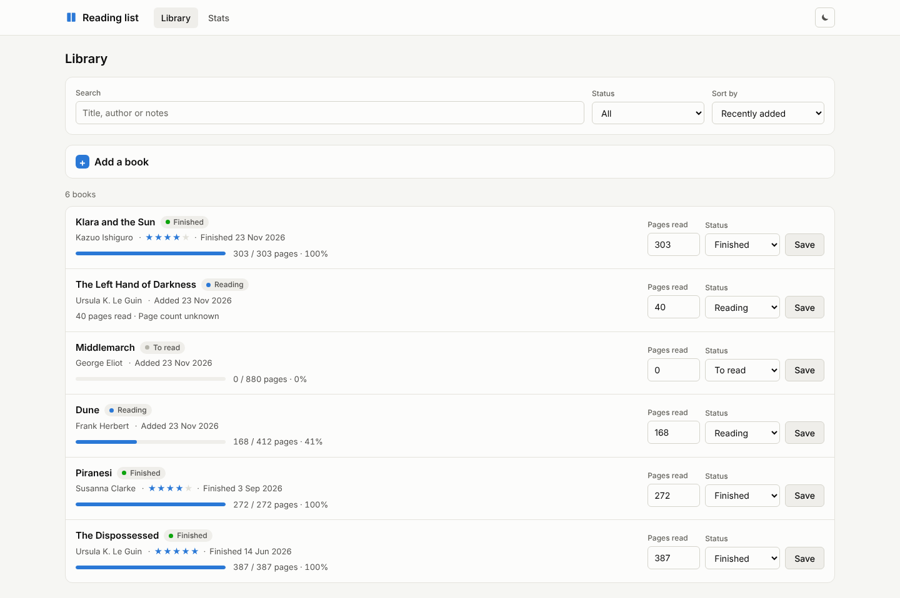
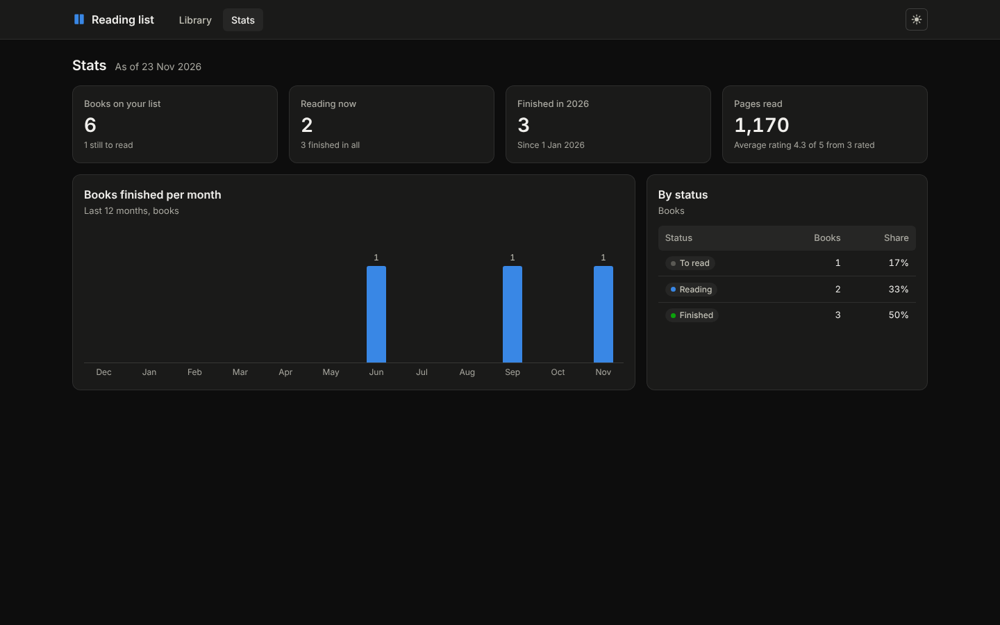

# 📚 Reading list

A small web app for keeping a reading list on your own machine: add books, track pages read, search and see your totals.



## Quick start

Install [uv](https://docs.astral.sh/uv/getting-started/installation/), then from a clone of this repository run:

```bash
uv run reading-list
```

Open <http://127.0.0.1:8000>.
The first run downloads Python 3.15 and the dependencies, which takes a minute.
Press Ctrl+C to stop.

## Use it

- **Add a book** — open *Add a book* on the library, fill in at least the title and press *Add book*.
- **Track progress** — type the pages read on the book's row and press *Save*.
  - Pages read above 0 moves a book from *To read* to *Reading*.
  - Reading every page marks it *Finished* and records the date.
  - Choosing *Finished* fills in every page.
- **Search** — type in the search box; the list filters as you type, on title, author and notes.
  Filter by status and sort by recently added, title, author or progress.
- **Edit or delete** — click a book's title.
- **See stats** — open *Stats* for books on the list, books reading now, books finished this year, pages read, the average rating, books finished per month and the split by status.
- **Switch theme** — the button at the top right swaps light and dark; the app follows your system until you choose.



## Settings

| Option | Environment variable | Default |
|---|---|---|
| `--port` | | `8000` |
| `--db` | `READING_LIST_DB` | `books.db` in your user data folder, such as `~/.local/share/reading-list/` on Linux or `~/Library/Application Support/reading-list/` on macOS |

```bash
uv run reading-list --port 8001 --db ~/books.db
```

The app listens on `127.0.0.1` only and refuses requests from other websites.
Your books stay in the one SQLite file; back it up by copying it.

## JSON API

A read-only view of the same data, documented at <http://127.0.0.1:8000/docs>:

- `GET /api/books` — every book, taking the library's `q`, `status` and `sort` query parameters.
- `GET /api/books/{id}` — one book.
- `GET /api/stats` — the totals.

## Develop

```bash
uv run coverage run -m pytest
uv run coverage report
uv run ruff check
uv run pyright
uv run pre-commit install
```

The plan is [`PLAN.md`](PLAN.md).
Inter is bundled under the [SIL Open Font License](https://openfontlicense.org).
